

# 🔐 Auditoria de Segurança
### Força Bruta e Password Spraying com Kali Linux e Metasploitable 2

  

**Projeto educacional de auditoria de autenticação em laboratório isolado.**

---

## 📌 Sobre o projeto

Este projeto documenta a preparação de um laboratório de segurança e a realização de testes controlados de autenticação utilizando **Kali Linux**, **Medusa**, **Hydra** e **Enum4linux**, tendo o **Metasploitable 2** como máquina vulnerável.

A atividade explora três cenários:

- **FTP:** enumeração do serviço e teste de credenciais com Medusa.
- **Aplicação Web (DVWA):** análise das requisições do formulário e teste automatizado com Hydra.
- **SMB:** enumeração de usuários e teste de autenticação com Medusa, seguido da validação com smbclient

⚠️ **Aviso:** Todos os testes descritos devem ser realizados exclusivamente em máquinas próprias ou em ambientes para os quais exista autorização expressa. Não execute essas técnicas contra sistemas de terceiros

## 🎯 Objetivos

- Compreender como funcionam ataques de força bruta e password spraying.
- Utilizar ferramentas de auditoria em um ambiente controlado.
- Identificar serviços expostos e informações úteis à avaliação de segurança.
- Documentar comandos, evidências, dificuldades e resultados.
- Reconhecer riscos de autenticação e propor medidas de mitigação

## 🧰 Ferramentas e ambiente

| Componente | Utilização |
|---|---|
| Kali Linux | Máquina de auditoria |
| Metasploitable 2 | Máquina vulnerável de laboratório |
| Medusa | Testes de autenticação em serviços |
| Hydra | Teste automatizado do formulário DVWA |
| Nmap | Enumeração de portas e serviços |
| Enum4linux | Enumeração de informações SMB |
| smbclient | Validação de acesso SMB |
| VMware / VirtualBox | Virtualização das máquinas |

**Configuração utilizada:** o laboratório foi montado com VMware.

---

## Downloads

- [Kali Linux](https://www.kali.org/get-kali/)
- [Metasploitable 2](https://sourceforge.net/projects/metasploitable/)

---

## 🗂️ Sumário

- [1. Preparação do laboratório](#1--preparação-do-laboratório)
- [2. Teste de força bruta no FTP](#2--teste-de-força-bruta-no-ftp)
- [3. Teste no formulário Web (DVWA)](#3--teste-no-formulário-web-dvwa)
- [4. Enumeração SMB e password spraying](#4--enumeração-smb-e-password-spraying)
- [5. Medidas de prevenção e mitigação](#5--medidas-de-prevenção-e-mitigação)
- [6. Resumo dos resultados](#6--resumo-dos-resultados)
- [7. Aprendizados e conclusão](#7--aprendizados-e-conclusão)

---

## 1. 🖥️ Preparação do laboratório

O laboratório utiliza duas máquinas virtuais conectadas por uma rede **Host-only**. Essa configuração permite a comunicação entre as VMs sem expor diretamente a máquina vulnerável à rede externa.

### 1.1 Configurar a rede das máquinas virtuais

Configure a interface de rede da VM Metasploitable 2 como `Host-only

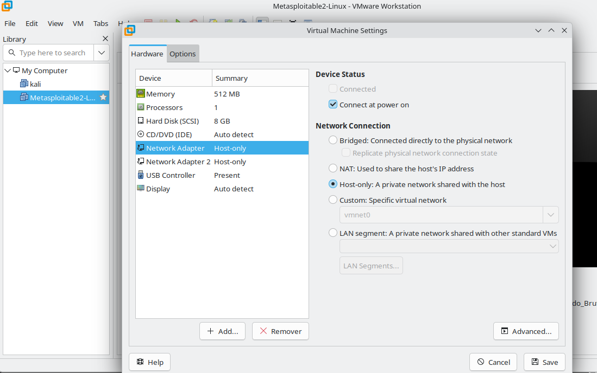

Repita a configuração na VM Kali Linux.

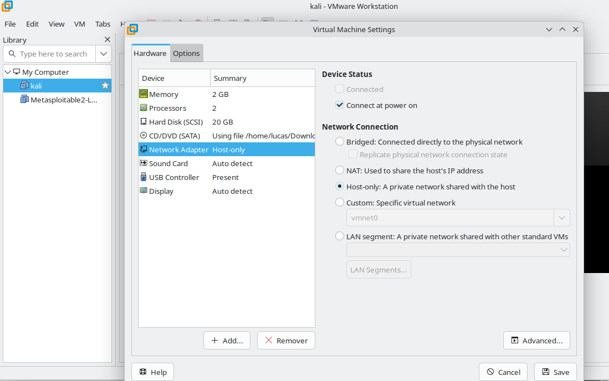

Com essa configuração, as máquinas ficam em uma rede isolada entre si.

⚠️ **Aviso:** Crie um snapshot da VM Metasploitable 2 antes de iniciar os testes. Isso facilita a restauração do ambiente caso alguma configuração seja alterada.

### 1.2 Identificar o endereço IP do alvo

`ip a`

Identifique e anote o endereço IPv4 da interface de rede.

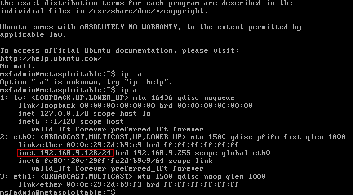

### 1.3 Testar a conectividade

Na máquina Kali Linux, verifique a comunicação com o alvo:

`ping -c 5 <IP>` 

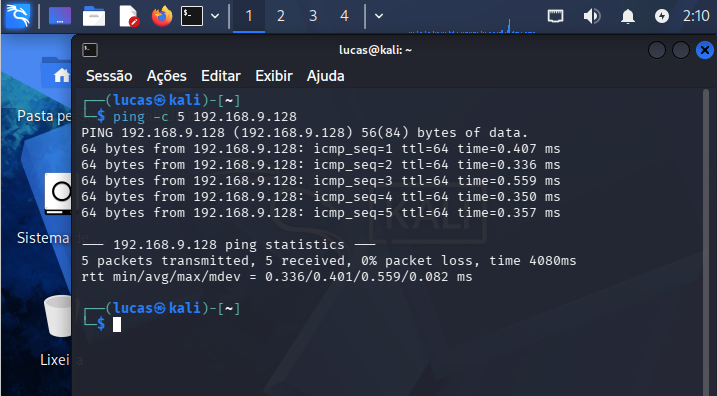

Se houver resposta, a comunicação entre as máquinas está funcionando.

---

## 2. 🔑 Teste de força bruta no FTP

O primeiro cenário consiste em identificar o serviço FTP no Metasploitable 2 e realizar um teste controlado de autenticação utilizando o Medusa.

### 2.1 Enumerar serviços com Nmap

Execute uma varredura de versões nas portas selecionadas:

`nmap -sV -p 21,22,80,445,139 <IP_ALVO>`

💡 **Sugestão:** Caso a resolução de DNS torne a execução mais lenta, utilize `-n` para desabilitá-la:

`nmap -sV -n -p 21,22,80,445,139 <IP_ALVO>`

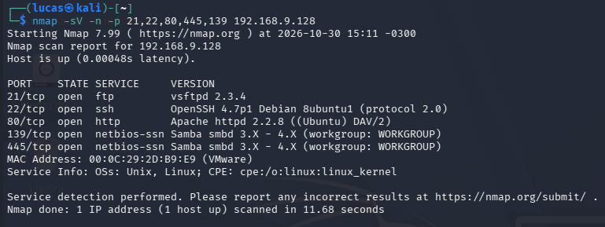

### 2.2 Verificar a conexão FTP

Tente estabelecer uma conexão com o serviço:

`ftp <IP_ALVO>`

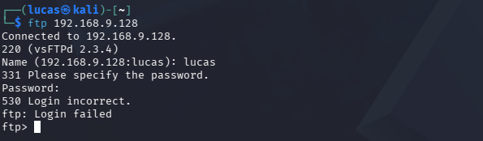

O serviço solicitará usuário e senha. A partir desse ponto, é possível preparar uma lista de credenciais para o teste controlado.

### 2.3 Criar as wordlists

Crie uma lista simples de possíveis usuários:

| Usuários |
|---|
| `user` |
| `msfadmin` |
| `admin` |
| `root` |

Gere o arquivo:

`echo -e "user\nmsfadmin\nadmin\nroot" > nome_do_arquivo_usuario.txt`

Crie também uma lista de senhas:

| Senhas |
|---|
| `123456` |
| `password` |
| `qwerty` |
| `msfadmin` |

Gere o arquivo:

`echo -e "123456\npassword\nqwerty\nmsfadmin" > nome_do_arquivo_senha.txt`

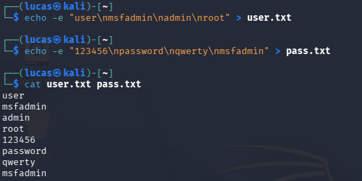

### 2.4 Executar o teste com Medusa

Utilize o comando abaixo, substituindo os parâmetros pelos valores correspondentes ao laboratório e ao módulo efetivamente utilizado:

`medusa -h <IP_ALVO> -U nome_do_arquivo_usuario.txt -P nome_do_arquivo_senha.txt -M <módulo> -t <quantidade de threads>`

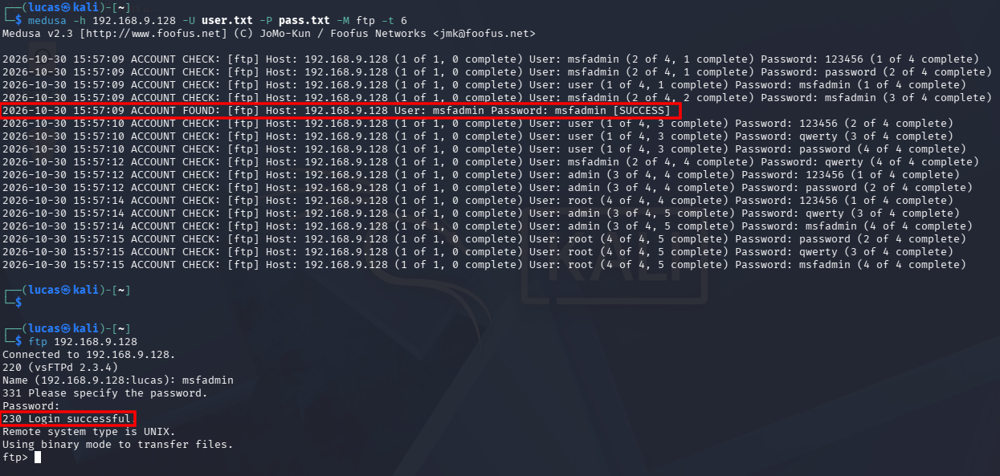

⚕️ **Síntese:** a enumeração inicial com Nmap permitiu identificar os serviços e suas versões. Essas informações ajudam a direcionar uma auditoria, investigar configurações inseguras e verificar a presença de credenciais padrão ou vulnerabilidades conhecidas.

---

## 3. 🌐 Teste no formulário Web (DVWA)

Neste cenário, o objetivo é compreender como os dados de autenticação são enviados pelo formulário do DVWA e realizar um teste automatizado em ambiente controlado.

### 3.1 Acessar o DVWA

No navegador do Kali Linux, acesse:

`http://IP_ALVO/dvwa/login.php`

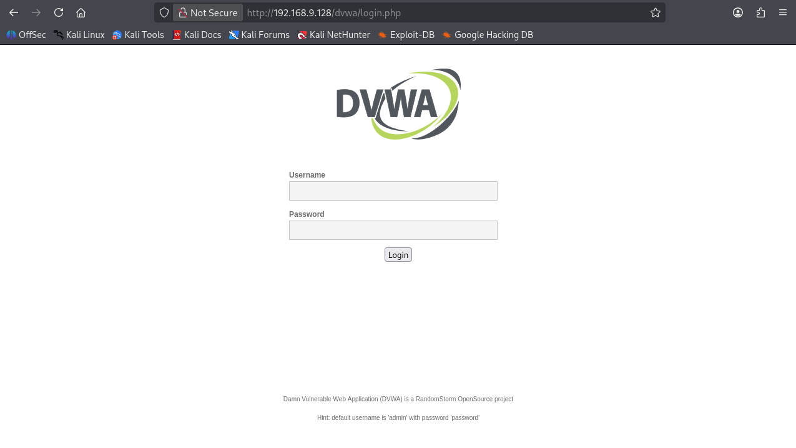

### 3.2 Inspecionar as requisições

Abra as ferramentas de desenvolvedor do navegador:

1. Clique no menu do navegador.
2. Acesse **More tools**.
3. Selecione **Web Developer Tools**.
4. Abra a aba **Network**.

💡 **Sugestão:** é possível evitar passar pelo menu pressionando ctrl+shift+i

As ferramentas de desenvolvedor permitem observar as requisições realizadas pelo formulário.

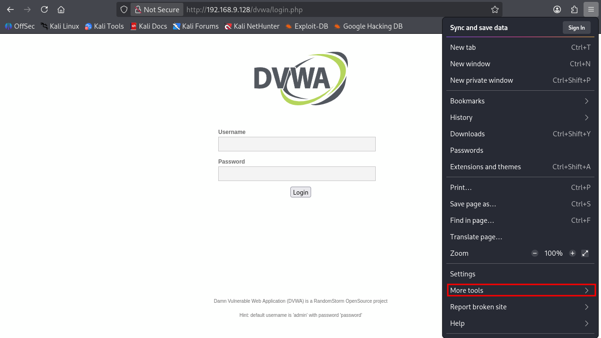

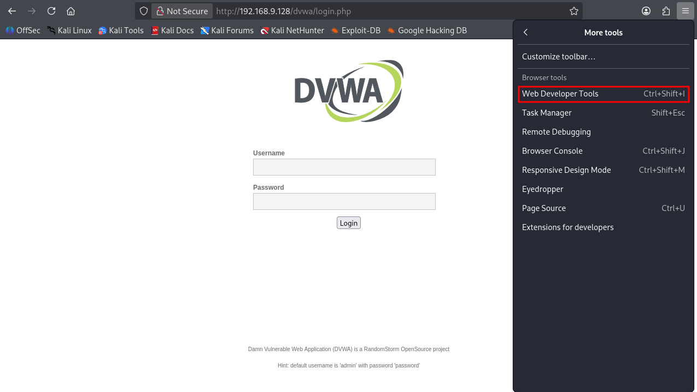

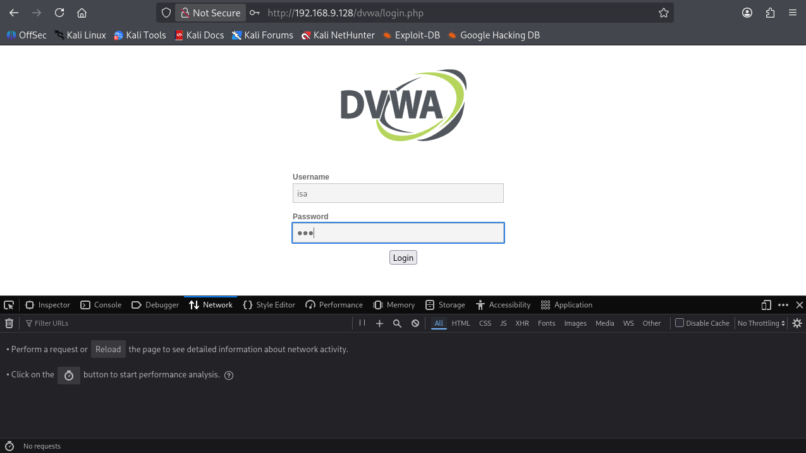

Inspecione uma requisição de login para identificar como os parâmetros do formulário são enviados.

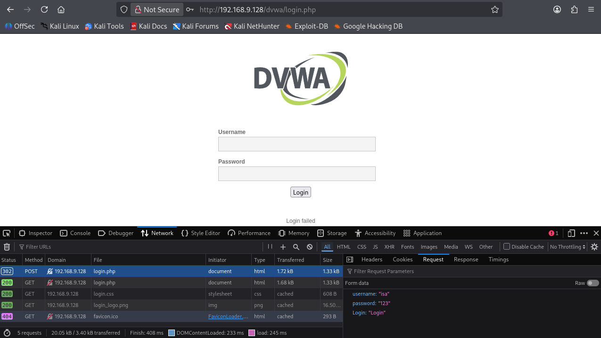

### 3.3 Executar o teste com Hydra

Para concluir esse cenário, foi utilizado o Hydra:

`hydra -L nome_do_arquivo_usuario.txt -P nome_do_arquivo_senha.txt <IP alvo> http-post-form "/dvwa/login.php:username=^USER^&password=^PASS^&Login=Login:F=Login failed"`

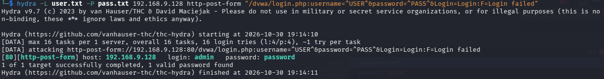

❗**Dificuldade encontrada:** durante os testes, houve dificuldade em utilizar o módulo web-form do Medusa para identificar corretamente o resultado da autenticação, especialmente devido ao redirecionamento HTTP 302 apresentado pelo DVWA. Para concluir o cenário, foi utilizado o Hydra, que permitiu realizar as tentativas e validar o acesso.

O comando do Medusa que também foi testado está registrado abaixo:

> medusa \
> -h < IP alvo > \\ \
> -U user.txt \\ \
> -P pass.txt \\ \
> -M web-form \\ \
> -m FORM:"/dvwa/login.php" \\ \
> -m DENY-SIGNAL:"Login failed" \\ \
> -m FORM-DATA:"post?username=&password=&Login=Login"

### 3.4 Validar o acesso

Após identificar as credenciais aceitas no laboratório, teste o login diretamente no DVWA.

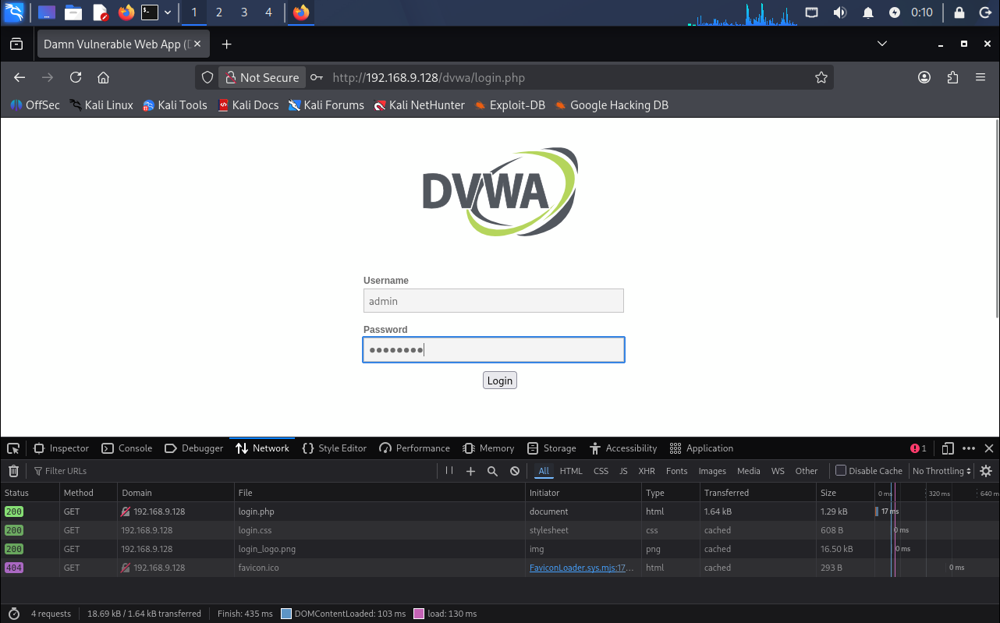

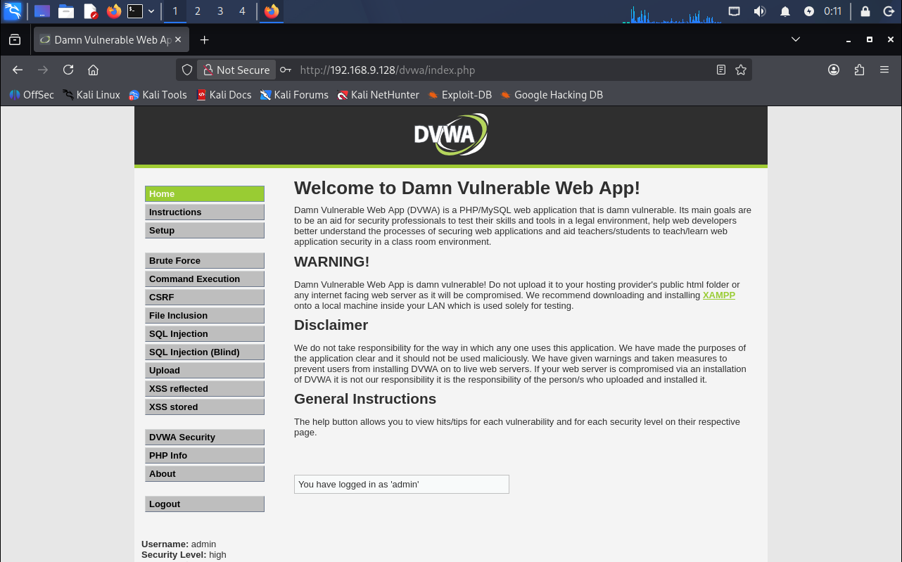

⚕️ **Síntese:** a inspeção da aba Network ajudou a compreender a estrutura da requisição HTTP e os parâmetros utilizados na autenticação. O cenário também demonstrou a importância de adaptar a ferramenta de auditoria quando surgem limitações técnicas.

Como referência para estudo de wordlists, consulte o projeto [SecLists](https://github.com/danielmiessler/SecLists).

---

## 4. 🗃️ Enumeração SMB e password spraying

O terceiro cenário utiliza o Enum4linux para coletar informações do serviço SMB, identificar usuários e preparar os testes de autenticação com Medusa.

### 4.1 Enumerar informações com Enum4linux

Execute:

`enum4linux -a <IP_ALVO> | tee arquivo_saida.txt`

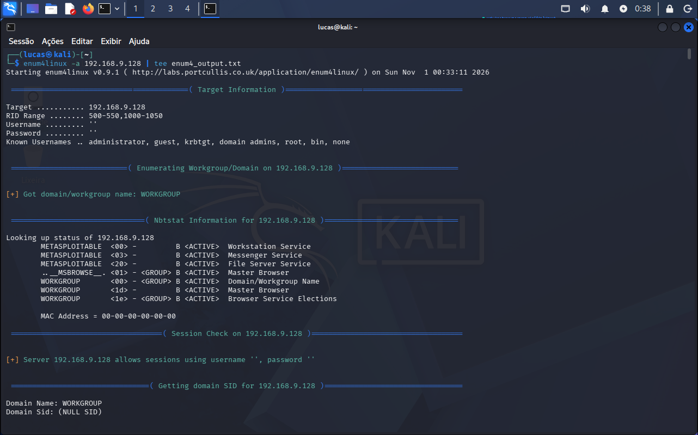

O parâmetro `tee` permite exibir a saída no terminal e salvá-la em um arquivo.

Para consultar o conteúdo posteriormente:

`more arquivo_saida.txt`

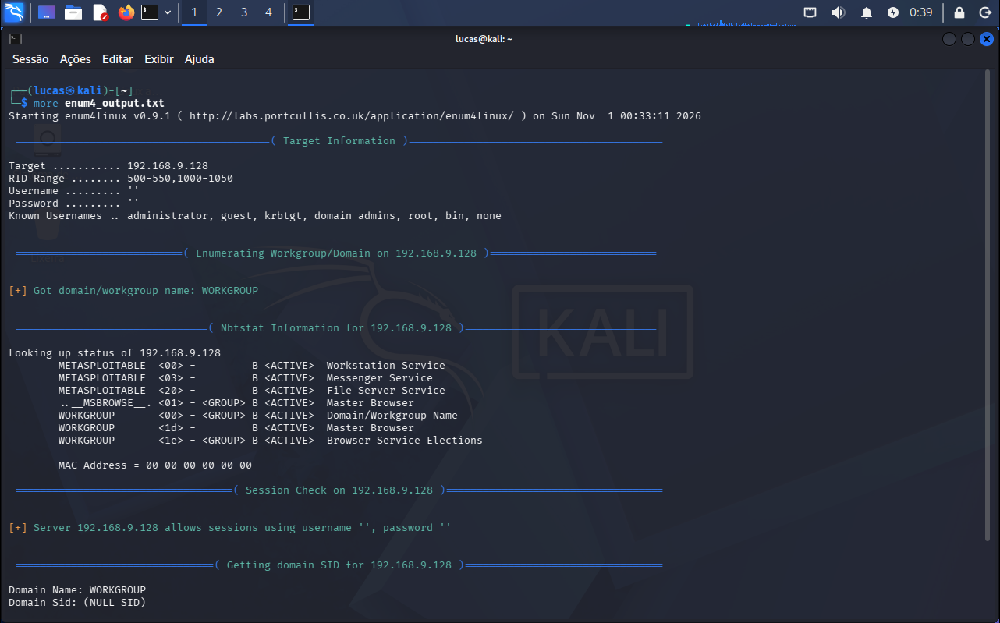

Procure no resultado os nomes de usuários identificados no sistema.

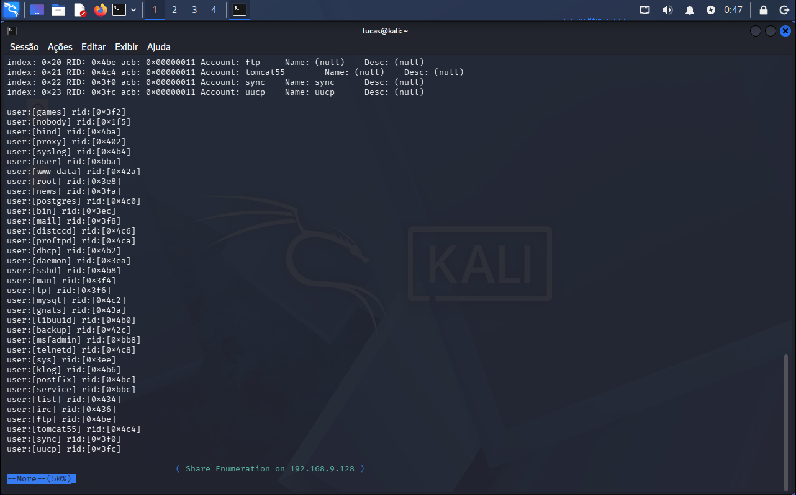

### 4.2 Preparar as listas de usuários e senhas

Crie a lista de usuários:

`echo -e "user\nmsfadmin\nservice" > arquivo_usuario.txt`

Crie a lista de senhas:

`echo -e "password\n123456\nWelcome123\nmsfadmin" > arquivo_senha.txt`

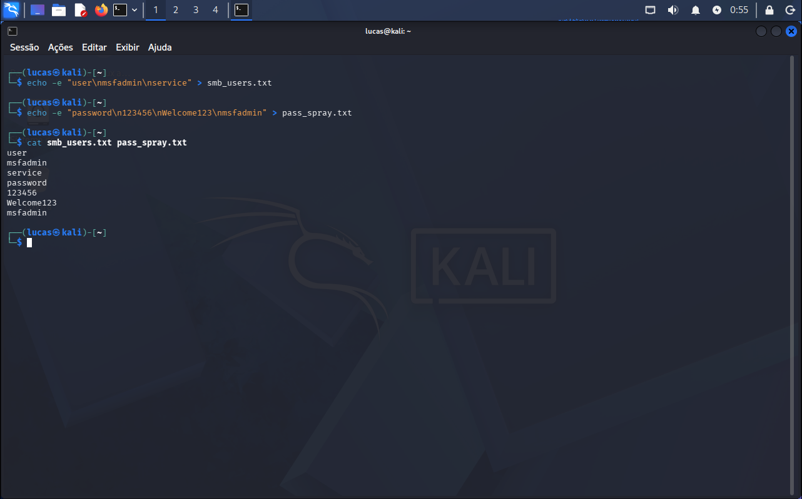

### 4.3 Executar o teste com Medusa

Com as listas preparadas, realize o teste de autenticação no serviço SMB. Substitua os parâmetros conforme a configuração utilizada no laboratório:

`medusa -h <IP_ALVO> -U <arquivo_usuario.txt> -P <arquivo_senha.txt> -M <módulo> -t <quantidade de threads> -T <número total de hosts simultâneos>`

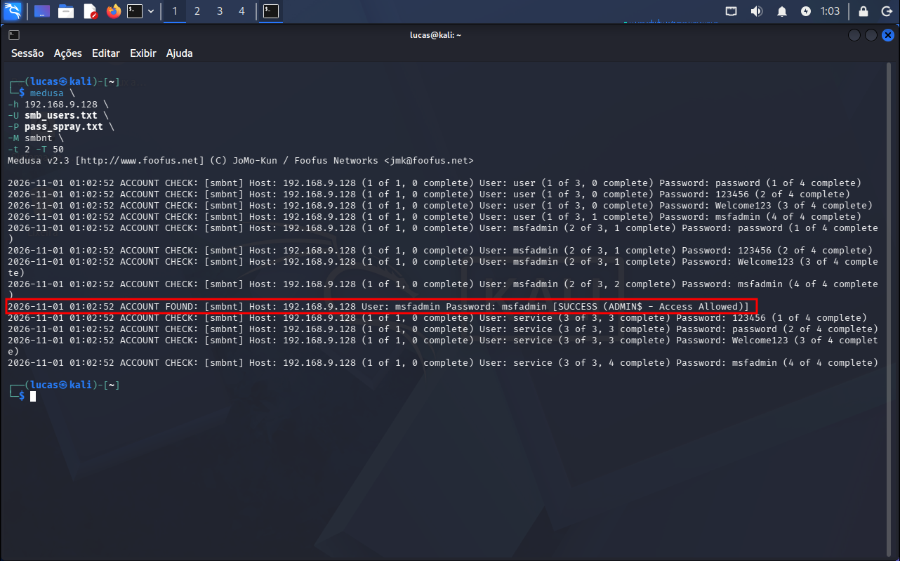

### 4.4 Validar a autenticação com smbclient

Utilize o smbclient para verificar o acesso:

`smbclient -L <//IP_ALVO> -U <usuário>`

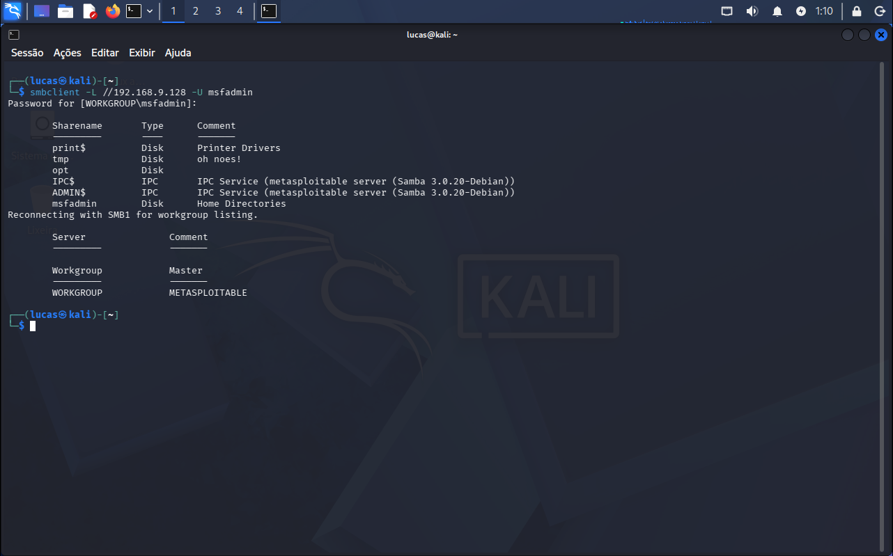

⚕️ **Síntese:** a enumeração permitiu identificar usuários existentes e direcionar os testes. O password spraying consiste em testar uma senha — ou um pequeno conjunto de senhas — contra vários usuários, em vez de concentrar muitas tentativas em uma única conta. Isso demonstra por que políticas de senha, monitoramento e proteção contra tentativas automatizadas são importantes.

---

## 5. 🛡️ Medidas de prevenção e mitigação

Os testes realizados ajudam a ilustrar riscos associados à autenticação. Algumas medidas que reduzem esses riscos são:

### FTP
+ Desabilitar o acesso FTP quando não for necessário
+ Preferir SFTP ou FTPS para transferências de arquivos
+ Utilizar senhas fortes e exclusivas.

### Aplicações Web (DVWA)
+ Implementar limitação de tentativas de login
+ Utilizar CAPTCHA após tentativas suspeitas
+ Implementar bloqueio temporário após várias falhas de autenticação
+ Utilizar autenticação multifator (MFA).

### SMB
- Desabilitar versões antigas e inseguras do SMB.
- Utilizar senhas fortes e políticas de bloqueio de contas.
- Restringir privilégios dos usuários.
- Monitorar tentativas de autenticação e identificar padrões de password spraying.

---

## 6. 📊 Resumo dos resultados

| Cenário | Ferramentas | Resultado documentado |
|---|---|---|
| FTP | Nmap + Medusa | Credenciais validadas |
| DVWA | Hydra | Tentativas realizadas e acesso validado |
| SMB | Enum4linux + Medusa + smbclient | Usuários enumerados e autenticação testada |   

A combinação de políticas de senhas fortes, autenticação multifator, monitoramento contínuo e limitação de tentativas de autenticação reduz significativamente a possibilidade de ataques bem-sucedidos.

---

## 7. 🎓 Aprendizados e conclusão

A execução deste laboratório permitiu explorar diferentes etapas de uma auditoria de autenticação: reconhecimento de serviços, preparação de wordlists, análise de requisições HTTP, enumeração de usuários e validação de credenciais.

Também foi possível observar que ferramentas diferentes podem apresentar comportamentos distintos diante de um mesmo cenário. A dificuldade encontrada com o módulo Web do Medusa e a utilização do Hydra como alternativa fizeram parte do processo de investigação e aprendizado.

A atividade reforça que serviços expostos, credenciais fracas ou padrão e versões antigas de software podem aumentar a superfície de ataque. Por isso, práticas como atualização, controle de acesso, senhas fortes, MFA e monitoramento são fundamentais para reduzir riscos.

### Principais conhecimentos praticados

- [x] Preparação de laboratório isolado com máquinas virtuais.
- [x] Enumeração de serviços com Nmap.
- [x] Criação de wordlists simples.
- [x] Testes de autenticação em FTP.
- [x] Inspeção de requisições HTTP e teste no DVWA.
- [x] Enumeração de usuários e teste de autenticação SMB.
- [x] Validação de acessos e estudo de medidas de mitigação.

⚠️ **Aviso de segurança:** Este projeto foi desenvolvido exclusivamente para fins educacionais, utilizando máquinas virtuais vulneráveis em ambiente controlado. Não utilize as técnicas apresentadas em sistemas de terceiros sem autorização expressa.
